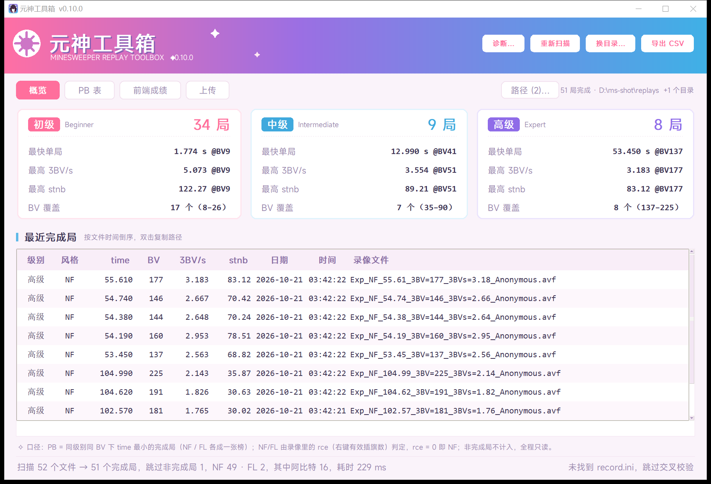
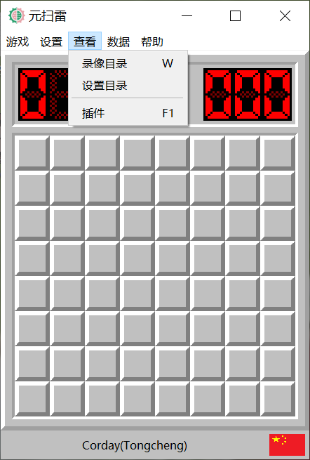
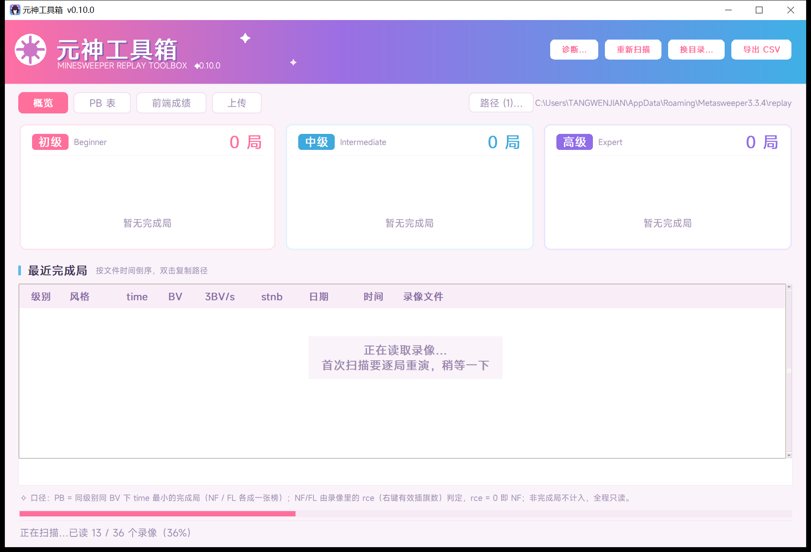
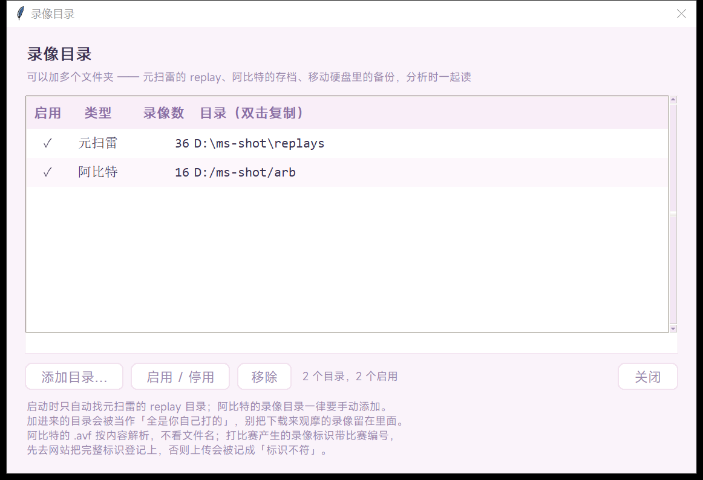
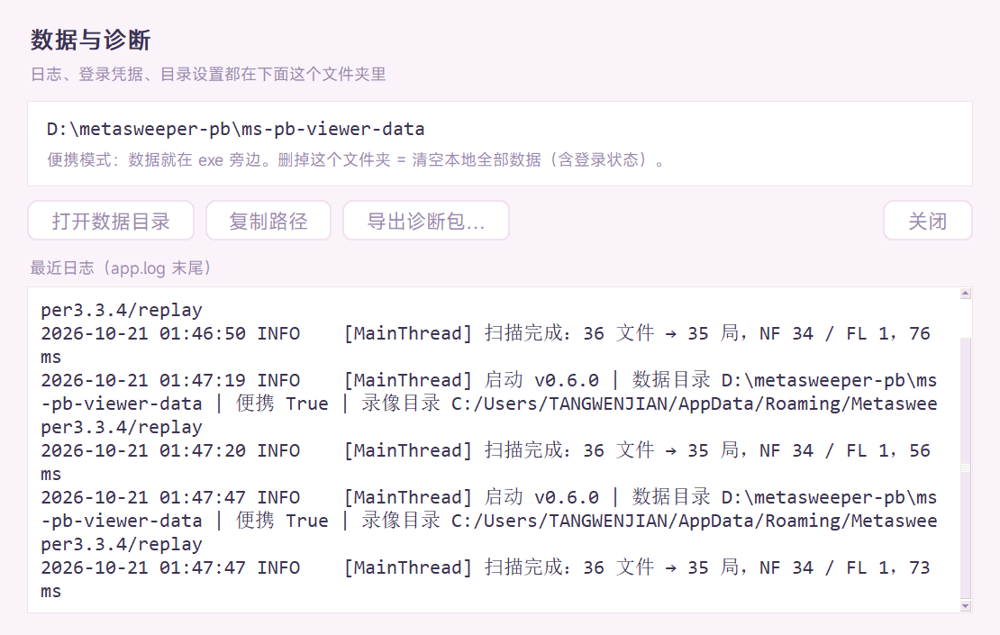
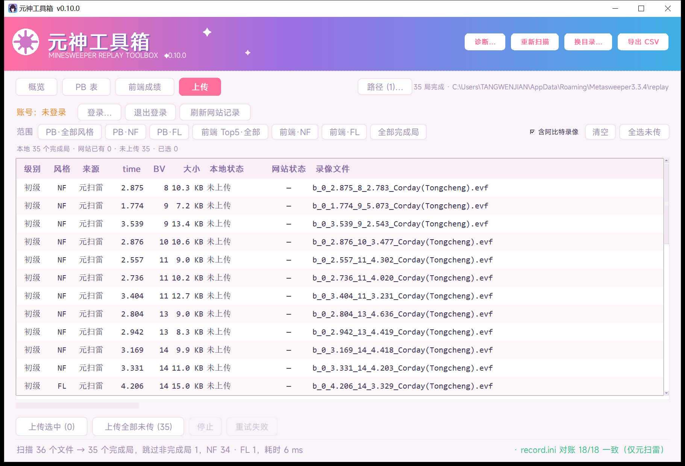
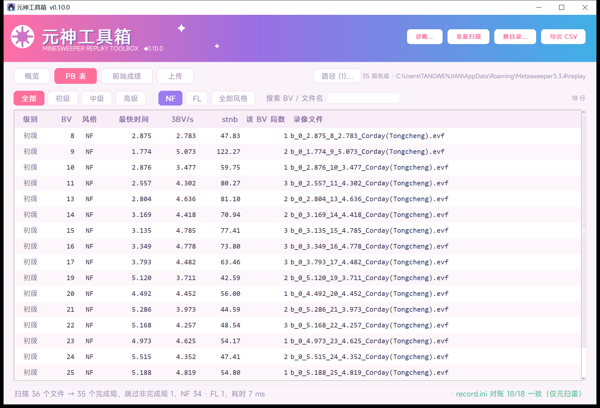
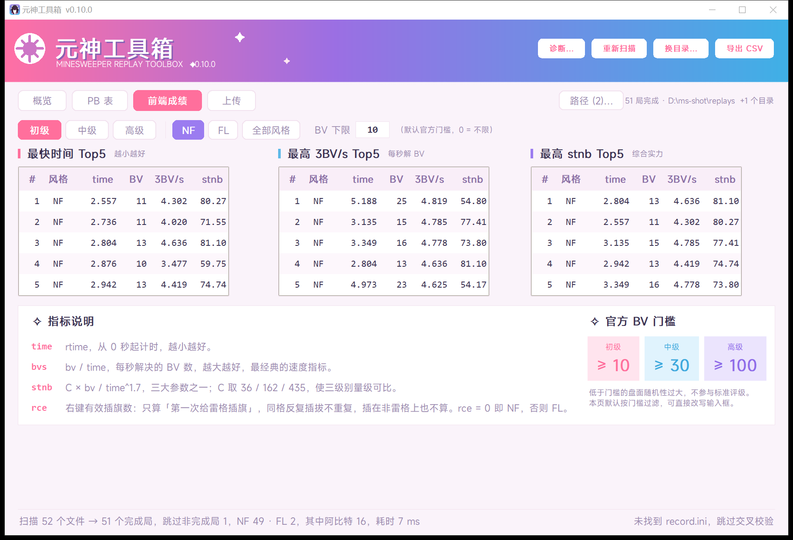

# 元神工具箱（Yuanshen Toolbox）

> 面向[开源扫雷网](https://openms.top)，兼容**元扫雷**和**阿比特**的扫雷录像分析工具。
>
> 作者：扫雷网 #27415 · 开源扫雷网 #3

扫描元扫雷（Metasweeper）的 `.evf` 和 阿比特（Arbiter）的 `.avf` 录像，统计四件事：

1. **PB 表** —— 每个（级别 × BV × 风格）下 `time` 最小的完成局
2. **前端成绩** —— 初级 / 中级 / 高级各自 `time`、`bvs`、`stnb` 的前五局
3. **NF / FL 判定** —— 用录像里的点击流重演，按 `rce` 区分无旗 / 有旗
4. **上传** —— 把本地完成局传到 [openms.top](https://openms.top)，自动跳过网站上已有的
   （阿比特的要不要一起传，上传页有开关）

原生 Windows 窗口（tkinter），不依赖浏览器、不起后台服务、只读录像。
界面走二次元清爽风（樱粉→薰衣草→湖蓝渐变），字体用小米 **MiSans**（已随 exe 打包）。



## 下载

到 [Releases](https://github.com/Corday-nkusky/yuanshen-toolbox/releases/latest) 下最新的
`YuanshenToolbox.exe`（单文件，约 27 MB），双击即用，不需要安装、不需要 Python。

> GitHub 的附件名不支持中文，所以发布时叫 `YuanshenToolbox.exe`；下载后**名字随意改**
> （推荐改成 `元神工具箱.exe`），程序照常运行。数据目录固定叫 `元神工具箱-data\`，
> 跟 exe 叫什么无关。0.10.0 及更早版本的数据目录 `ms-pb-viewer-data\` 会在启动时自动改名，不丢数据。

---

## 用法

1. 下载 `YuanshenToolbox.exe`（GitHub 不支持中文附件名；下载后可改名，不影响任何功能），
   **推荐放到元扫雷 `replay` 目录的同一级**
   （也就是 `Metasweeper<版本号>` 目录里）。不知道 `replay` 在哪的话，
   打开元扫雷菜单「查看 → 录像目录」（快捷键 `W`）就能打开它，返回上一级就是推荐安装位置：

   

2. 双击运行。程序会优先认 exe 旁边的 `replay`，连选都不用选；没找到也会自己搜
   `%APPDATA%` / `%LOCALAPPDATA%` 下所有 `Metasweeper*` 的 `replay`
   （版本号不限，多个版本并存时全部收进来，录像最新的排最前）。
3. 都没有才让你手动选 —— 指向元扫雷的 `replay` 目录即可：

   ```
   %APPDATA%\Metasweeper3.3.4\replay
   ```

4. 选一次就记住，以后双击直接出结果。

> **读取时有进度条**：窗口一亮就开始清点录像文件（零头都不到一秒），随后底部出现一条
> 进度条和「已读 12345 / 22320 个录像（55%）」，概览页正中写着「正在读取录像…」。
> 第一次扫描要逐局重演录像（2 万局约 3 分钟），之后走缓存是一秒级；扫描在后台线程，
> 进度条不会卡住窗口。



> **阿比特的录像目录不会自动加入。** 阿比特的安装目录里往往还堆着从网上下载来观摩的
> 录像，自动收进来就会把别人的成绩算成你的。要加就在「路径…」里手动添加，
> 添加前程序会问一句「这里面的每一条录像都算你自己打的，确定吗」。

> 目录和登录状态都记在 exe 旁边的 `元神工具箱-data\` 里（见「数据存在哪」），
> 删掉这个文件夹就回到全新状态。

> 扫描会递归子目录（方便按年份/级别分文件夹的存档），但**最多 20000 个子目录**
> —— 实测约 3–5 秒。这是防止误选 `C:\`、整个用户目录时界面卡死；真到上限会在
> 状态栏写明「只扫了前 N 个子目录」，把目录直接指到 `replay` 即可。

### 多个目录 / 阿比特录像

阿比特（Arbiter）存的是 `.avf`，跟元扫雷的 `.evf` 一起算进同一套 PB 和前端成绩
——它们本来就是同一个人的成绩，分成两套榜没有意义。

点导航行右侧的 **「路径 (N)…」**：



- **添加目录…** —— 想加几个加几个（阿比特的 `replays`、按年份归档的备份、移动硬盘…）。
  **加之前会先确认：这个目录（含子目录）里的每条录像都当作你自己打的** ——
  会计入 PB，也会进上传列表。所以要先把下载来观摩的录像挪出去。
- **启用 / 停用** —— 停用的目录这次不参与扫描，配置还留着
- 列表里会写明每个目录认出了多少局元扫雷 / 阿比特录像

没有新增页签：阿比特只是在「路径」里多一条，谁有 `.avf` 就自动按阿比特解析。


| 行为 | 元扫雷 `.evf` | 阿比特 `.avf` |
|---|---|---|
| 级别 / 时间 / BV | 文件名 + 录像内容互校 | **只认录像内容**（文件名规则不统一） |
| 「文件名与录像不符」检查 | 有 | 没有（文件名的意义本来就不同） |
| 参与 PB / 前端成绩 | 是 | 是 |
| 参与 `record.ini` 对账 | 是 | 否（record.ini 是元扫雷写的） |
| 上传 | 可以 | 上传页「含阿比特录像」勾选后才传 |

> 两个软件的**标识**是同一套规则（`玩家名(地区)`）；打比赛的录像标识后面会多带比赛编号，
> 例如 `玩家名(地区) G18248` —— 那是比赛标识，不是另一种格式。网站的规则是「只认你登记过的
> 标识」，哪条录像上传后被记成 `d`（标识不符）、不进榜，就把它那个完整标识（含编号）登记到
> 账号「标识管理」里再传。没登记时本程序在上传列表里就会提前标「标识不符」，不会白传。

### 同一局存了多份

阿比特破纪录时会在旁边额外导出一份 `HI-SCORE *.avf`，内容和它自己 `replays`
目录里的正本逐字节相同；归档子目录（比如整包下载的 `gsc\...`）也常和 `replays`
各存一份。这种重复**只算一局**，磁盘上一个文件都不动。

判定只看**文件字节**，不看指标：阿比特录像的时间只有 10 ms 精度，同级别、同 BV、
同时间的不同局很常见，按指标合并会误删真局。保留的是「文件名不带 `HI-SCORE`
→ 目录层级浅 → 路径字典序」里的第一份，所以双击复制到的是正本路径。

这件事在界面上不体现（状态栏的「文件数 → 局数」就是去重后的结果），只留在日志里。

界面操作：

| 操作 | 效果 |
|---|---|
| 点表头 | 按该列排序，再点一次反向 |
| 双击某行 | 复制该录像的完整路径 |
| 「重新扫描」 | 重扫目录（新打了局就点这个） |
| 「换目录…」 | 换掉**主目录**，其他目录保留 |
| 「路径…」 | 增删录像目录、启用/停用 |
| 「导出 CSV」 | 把 PB 表存成 CSV（UTF-8 BOM，Excel 直接开） |
| 「诊断…」 | 看数据目录、最近日志，导出诊断包、清空扫描缓存 |

### 扫描缓存

每局录像解析出来的指标（rce / BV / 时间 / 标识 / 审核码）按 `(修改时间, 大小)`
缓存在 `scan-cache.db` 里，录像没变就不再重演。判重用的文件哈希也存在同一个库
（`file_sha` 表），所以第二次扫描连字节都不用再读。

实测 23,183 个阿比特录像：**首次 173.5 s → 之后 0.9 s**（缓存库 8 MB）。
新打的局只解析新增的那几个。怀疑数据不对时，在「诊断…」里点「清空缓存」重扫即可。

---

## 数据存在哪 / 怎么清干净



所有运行期产生的东西都在 **exe 同目录的一个文件夹**里，不散落在 `%APPDATA%`：

```
<exe 所在目录>\元神工具箱-data\
    config.json        录像目录等界面设置
    openms.json        用户名 + 密码/会话的 DPAPI 密文
    uploads.json       上传台账（断点续传用，只记去重键与时间）
    scan-cache.db      录像解析结果缓存（删了只是下次扫描变慢）
    logs\app.log       运行日志（1 MB 滚动 3 份）
    logs\crash-*.txt   崩溃时的完整 traceback
```

**删掉这个文件夹 = 回到全新状态**（目录要重选、账号要重登）。

只有两种情况不在这里：

| 情况 | 实际位置 |
|---|---|
| exe 放在不可写的地方（如 `C://Program Files`） | 自动回落到 `%APPDATA%\元神工具箱\`，「诊断…」里会写明 |
| 一键打包的临时解压目录 | `%TEMP%\_MEIxxxx`，程序退出即删除（PyInstaller 行为） |

从旧版本升级时数据自动跟过来：0.10.0 及更早的 `ms-pb-viewer-data\` 会被整体改名成
`元神工具箱-data\`；数据只在 `%APPDATA%\ms-pb-viewer` 的更老版本，`config.json` 与
`openms.json` 会自动搬过来，不用重新登录；搬完空的旧目录会被删掉。

### 日志与崩溃

打包成窗口程序（`--windowed`）后没有控制台，未捕获的异常原本会让窗口直接消失、
什么都不留。现在三处异常都被接管：主线程、子线程、Tk 回调。
崩溃时会写 `logs\crash-<时间>.txt` 并弹一个**带路径**的提示框。

日志里只有事件和结果，不含密码、验证码、Cookie。要报问题时点「诊断…」→「导出诊断包…」，
生成的 zip 里是：`system.txt`（版本、系统、DPI、ms-toollib 版本、凭据「有没有」的摘要）、
`config.json`、`logs\*`。**凭据只写「有没有、用户名是谁」，不含任何密文。**

---

## 上传到开源扫雷网（openms.top）

「上传」页把本地完成局传到 [openms.top](https://openms.top) 的排行榜。



### 第一次用

1. 点「登录…」，输用户名、密码、验证码（点验证码图可以换一张）。
2. 勾着「保持登录 90 天」登录一次就行，之后**不用再输密码**。

### 为什么只要输一次验证码

站点的验证码只在「登录」这一步出现，一次性有效（成功失败都作废）；
登录成功后服务端返回 `session_id` Cookie，站点允许最长 90 天，且每次请求都会自动续期。
所以程序保存的是 **Cookie**，不是密码：

| 存什么 | 效果 |
|---|---|
| 密码 | 只能自动填表，**每次仍要输验证码** |
| `session_id` | 真正的长期免登录，90 天不失效就一直不用管 |

密码也会一并存下来（只用于下次自动填好输入框）。

凭据存在数据目录的 `openms.json`（默认 `<exe 所在目录>\元神工具箱-data\`），
密码与 Cookie 都是 **Windows DPAPI 密文**（绑当前 Windows 用户 + 本机，换机器解不开），
文件里查不到明文。

### 选范围

「范围」那一排可以**多选叠加**，点一下即自动勾选对应录像：

| 范围 | 含义 |
|---|---|
| PB·全部风格 | 每个（级别 × BV）的最快局，NF/FL 里取更快的那个 |
| PB·NF / PB·FL | 同上，只取该风格 |
| 前端 Top5·全部 | 三级别 × time / 3BV/s / stnb 各自前 5（按官方 BV 门槛过滤） |
| 前端·NF / 前端·FL | 同上，按风格过滤 |
| 全部完成局 | 本地所有完成局 |

也可以在表格里 Ctrl / Shift 手动多选，或点「全选未传」，再点「上传选中」。

范围右侧的 **「含阿比特录像」** 决定阿比特的 `.avf` 参不参与这次上传（默认勾上）。
取消后表格里只留元扫雷的局，统计行会写明「阿比特 N 个，已排除，不传」；
这个选择记在 `config.json` 的 `upload_arb` 里，下次打开照旧。

### 不会重复上传

上传前先拉 `GET /api/userprofile/videolist?user_id=N` 取回网站上已有的录像，
按站点自己的去重口径 **timems + bv + file_size** 逐个比对（实测这三个字段与本地完全吻合），
已经传过的直接标成「网站已有」，不会进入待传集合。

另外三道兜底：

1. 站点对同一文件返回 `file/collision`（本程序当作「已有」处理）；
2. **本地台账** `uploads.json`：每传成功一条就记下 `timems/bv/file_size`。
   断网、崩溃、关程序之后重开，还没联网拉到网站列表时也不会把它们当成「未上传」
   （界面上标「已传过（本地记录）」）。一旦拉到了网站列表，就**以服务器为准**——
   网站上删过的录像会重新变回「未上传」；
3. 一批传完后会重新拉一次网站数据，把每行的状态校正成服务端真实结果。

### 表格状态怎么看

| 列 | 取值 |
|---|---|
| 本地状态 | 未上传 / 网站已有 / 已传过（本地记录）/ 上传成功 / 失败：原因 / 标识不符 / 会被冻结 / 待人工审核 |
| 网站状态 | 已通过（c）/ 待审核（a）/ 已冻结（b）/ 标识不符（d）/ 外部审核（e） |

「标识不符」是**本地预检**结论：录像里的 `player_identifier` 与你账号「标识管理」里的
任何一条都不完全一致（空格、全角半角都算不同）。这种传上去也**不进任何榜单**，
先把标识改对再传。

### 上传行为

- 串行，每个之间间隔 350 ms（站点限流 5 次/秒/IP，站点自己的前端用 200 ms）。
- **单条失败不拖垮整批**：每条上传内部会重试——断网/超时按 1s → 2s → 4s 退避，
  `503`（写锁）与 `429`（限流）听 `Retry-After`。重试耗尽仍失败的记为「失败：原因」，
  接着传下一条。
- 只有**账号级**错误才停整批：`403`（登录失效）、`402`（配额满，默认每账号 100 条）、
  未实名、被封禁——这些后面每一条都会同样失败。
- 网络**连续 3 条**失败就认为断网，主动停批（避免白等 N 个 90 秒超时）。
  已成功的不受影响，恢复后点「重试失败 (N)」只补传剩下的。
- 断点续传：传一半关掉程序，重开后已成功的那几条不会重传。
- 上传成功 ≠ 进榜：`a` 待审核 / `b` 冻结 / `d` 标识不符都不进榜，界面按 state 分开显示。
- 只传完成局。`_fail` 局在扫描阶段就已经被排除，站点也会拒。

---

## 统计口径

| 名词 | 定义 | 来源 |
|---|---|---|
| `time` | `rtime`，从 0 秒开始计时 | 录像文件头 |
| `bvs` | `bv / time` | 文件名 + 复算 |
| `stnb` | `sqrt(completion) × C / qg`，`qg = time^1.7 / bv` | 官方公式 |
| `completion` | `bvdone / bv` | 完成局恒为 1 |
| `C` | 初级 36 / 中级 162 / 高级 435 | 官方给定 |
| `rce` | 右键有效插旗数 | ms-toollib 重演录像 |

完成局（`completion = 1`）化简后：

```
stnb = C × bv / time^1.7
```

常数来源：<https://openms.top/docs/guide/minesweeper/stat>（开源扫雷网《扫雷数据》）。

**非完成局不参与任何统计**：文件名带 `_fail` 的录像直接跳过。

### BV 下限（官方门槛）

「前端成绩」页的 **BV 下限** 默认按官方标准评级门槛取值，切级别时自动跟着换：

| 级别 | 门槛 |
|---|---|
| 初级 | ≥ 10 |
| 中级 | ≥ 30 |
| 高级 | ≥ 100 |

低于门槛的盘面随机性过大，成绩不参与标准评级，所以默认就过滤掉。
输入框可以随时改写，填 `0` 表示不限。

---

## NF / FL 判定（rce）

**rce = Right Click Effective，右键有效点击数**。判定口径与
[eee555/ms-toollib](https://github.com/eee555/ms-toollib) 一致：

```rust
// minesweeper_board.rs::right_click
if self.board[x][y] == -1 && !self.flaged_list.contains(&(x, y)) {
    self.rce += 1;                      // 只算「第一次给雷格插旗」
    self.flaged_list.push((x, y));
}
// base_video.rs
self.nf = b.rce == 0;                    // rce == 0 → NF
```

三条要点，都是实测确认过的：

1. **只统计雷格**：右键插在非雷格（数字/空格）上，`flag` 会变但 `rce` 不加。
2. **同一格去重**：插旗 → 取消 → 再插，只算 1 次（`flaged_list` 记过就不再计入）。
3. **只看「第一次标出」**：所以 `rce` 恒 ≤ 雷数。

程序的做法是：读出 `.evf` 里的棋盘与完整点击流，按 ms-toollib 的状态机重演一遍，
取整局累计的 `rce`。`rce == 0` → **NF**，否则 → **FL**。

### 为什么必须分开排名

NF 与 FL 是两张独立的榜。混在一起时，同 BV 下更快的 NF 局会把 FL 的最好成绩盖掉。
本机数据里就有现成例子：BV=14 有两局 ——

```
3.169s  NF   ← 混合排名时这条胜出，FL 的成绩完全看不到
4.206s  FL   (rce = 2)
```

所以 PB 表按 `(级别, BV, 风格)` 分行，界面用「NF / FL / 全部风格」切换。



前端成绩页每级别三张 Top5（最快时间 / 最高 3BV/s / 最高 stnb）：



### 验证

本机 35 个完成局（34 NF + 1 FL）逐局重演，`bbbv_solved` 与文件头 `bbbv` **全部吻合**
（唯一的例外是失败局，解了 4 个 BV 后踩雷，与文件名里的 `3.500 × 1.143 ≈ 4` 一致）。

那条 FL 局的右键落点也逐条核对过：

```
t=1.198  rc  cell(2,0)  board=-1  useful_level=1   ← 雷，计入 rce
t=1.423  rc  cell(3,1)  board= 1  useful_level=0   ← 非雷，不计入
t=1.801  rc  cell(4,3)  board=-1  useful_level=1   ← 雷，计入 rce
```

最终 `rce = 2`、`flag = 2`，与定义完全一致。

> 采信的是 ms-toollib 的口径：**错旗不影响 NF 判定**。一局如果只在非雷格上乱插旗、
> 从没标到过雷，`rce` 仍是 0，依然判为 NF。这与「零旗」的直觉定义有细微差别。

---

## 图标怎么来的（任务栏清晰度）


一开始的做法是「1024 母版缩成 7 档塞进 ico」，结果任务栏上只有一个黑团。两个原因叠在一起：

1. **画面不适合小尺寸**：整张头像缩到 36px，脸只剩十来个像素，深紫黑发贴在深紫底上，只剩一坨黑。
2. **尺寸被二次缩放**：Tk 的 `iconbitmap` 只往窗口塞 **一张** HICON，任务栏按 24dp × 缩放
   渲染（本机 150% → 36px），把那 32px 的位图硬拉到 36，边缘必糊。

对应两条修法：

- **小尺寸单独一套画面**（`_ms/make_icon2.py`）：16/20/24/30/32/36/40/42/48 用「脸部紧裁 + 中调紫蓝底 +
  深紫描边」，靠「黑发剪影 + 白色眼罩横带」这对强对比特征保辨识度；64 以上才用原设计（白圆环）。
  PIL 的 ICO 保存只能一份源图缩所有档，所以脚本自己按 ICO 格式写文件，各档塞各自的画面。
- **窗口图标按任务栏像素精确加载**：`GetDpiForWindow` 算出 24dp 对应的物理像素（本机 36），
  `LoadImage(cx=cy=36)` 取精确档，再 `WM_SETICON(ICON_BIG/ICON_SMALL)`。1:1 落地，不再缩放。
  ico 里的 30/36/42 是非标准档，专门给 125%/150%/175% 缩放用。

验证方式：把 ico 每档涂成不同纯色，跑起来截任务栏看命中哪一档（实测 150% 下走 36 档）。

---

## 文件名格式

实测样本（b/i/e 共 35 个）：

```
b_0_1.774_9_5.073_PlayerName(Region).evf
│ │  │     │  │      └ 玩家名
│ │  │     │  └ bvs（文件名保留 3 位小数）
│ │  │     └ bv（3BV）
│ │  └ time（rtime）
│ └ 第二字段：样本全为 0，含义未确认
└ 级别 b/i/e
```

失败局文件名以 `_fail` 结尾，且 `bvs` 字段是 `bvdone / time` 而非 `bv / time`
（实测：`e_0_1.143_174_3.500_fail.evf` → `3.500 × 1.143 ≈ 4`，即只完成 4 个 BV）。

### 校验

`record.ini` 里 `[BEGINNER]/[INTERMEDIATE]/[EXPERT]` 段本身就是「每个 BV 的最快时间」表，
程序会拿它和扫描结果逐条对账，结果显示在状态栏右下角。样例数据：**18/18 全一致**。
只拿元扫雷的局去对账（阿比特的成绩不在 record.ini 里）。

### 阿比特（`.avf`）

实测到的两种文件名写法（同一个人的存档里混着）：

```
HI-SCORE Beg_1.00_3BV=6_3BVs=6_Anonymous.avf
Beg_NF_1.06_3BV=5_3BVs=4.71_Anonymous.avf
```

前缀 `HI-SCORE`、中缀 `_NF_` 都不稳定，`3BV=`/`3BVs=` 也有的文件不带。
所以**文件名只用来兜底**：程序读录像内容拿级别 / 时间 / BV，读不出才退回文件名解析
（`core.parse_avf_filename`，认不出就跳过并计入「无法解析」）。

阿比特录像里的 `player_identifier` 写法和元扫雷同一套（`玩家名(地区)`）；个别录像后面
多带的编号（如 `PlayerName(Region) G00000`）是**比赛标识**（打比赛产生的录像才带），
不是另一种格式 —— 若上传被记成 `d`（标识不匹配），把带编号的完整标识登记到账号下即可。

---

## 没验证的部分

- **文件名第二个字段（`0`）的含义**：35 个样本全是 0，仍无法推断。可能是 flag 数或模式变体。
  现在 NF/FL 由 `rce` 直接判定，不再依赖这个字段，所以不影响统计。
- **失败局的 stnb**：本版本直接跳过非完成局，未实现。
- **rce 解析失败时的降级**：若某局录像损坏或格式不认，该局风格显示 `?`，
  并计入状态栏的「rce 失败」数；此时风格筛选会自动退回「全部风格」，不会把数据藏起来。
- **日期取文件修改时间**（mtime），不是录像内嵌时间。若文件被复制/移动过，日期会不准。
- **文件名与录像内容的一致性是「检查」而非「拦截」**：程序会比较文件名里的 `bv`/`time`
  与录像内的真实值，不符时在状态栏标出「文件名与录像不符」，但统计仍按文件名走
  （保持与 `record.ini` 对账口径一致）。真要做成「以录像为准」需要先确认改名场景的真实分布。
- **阿比特的文件名解析只覆盖了实测到的两种写法**（`[HI-SCORE] Beg[_NF]_time_3BV=n_3BVs=x_玩家`）。
  玩家名在前、或完全不带 `3BV=` 的命名解析不出来，只能靠录像内容兜底。
- **扫描缓存不做过期剪枝**：录像被删掉或改名后，缓存里会留下孤儿行（只是占点磁盘，
  不影响结果）。要清就「诊断…」→「清空缓存」。
- **阿比特上传只做过单条真传**（2026-10-21：1 条 `.avf` 上传成功，站点记为 `d` 标识不匹配
  —— 那条的标识带比赛编号、账号里没登记；重复上传正确返回「网站已有同一录像」）。
  批量混传还没在真实账号上跑过。

---

## 技术栈

一句话：**Python 3 + tkinter/ttk 原生窗口，PyInstaller 打成单文件 exe；
唯一的第三方运行时依赖是 ms-toollib（Rust 写的 `.evf` 解析扩展）。
没有 Electron、没有 webview、没有浏览器、没有后台服务。**

### 总览

| 层 | 选型 | 用途 / 说明 |
|---|---|---|
| 语言 | **Python 3.13**（打包用 3.13.5 / 64 位） | 除 ms-toollib 外只用标准库 |
| **GUI 框架** | **tkinter（Tk 8.6.14，Python 自带）** | 不是 Qt / wxWidgets / Electron / Tauri |
| **主题与控件** | ttk + **`clam` 主题**，`ttk.Style` 改色 | 不用图片皮肤，配色全在代码里 |
| **表格** | **`ttk.Treeview`**（`show="headings"`）+ `ttk.Scrollbar` | 点表头排序、双击行复制路径 |
| **自绘组件** | **`tk.Canvas`**：渐变横幅、圆角按钮 `Pill`、统计卡 `StatCard` | 圆角/渐变全用图元画，零图片素材 |
| 布局 | `pack` + `grid` 混用，所有尺寸过 `sc()` | 一套代码适配 100% / 150% 缩放 |
| 字体 | **MiSans** Regular + Demibold（随 exe 打包） | GDI `AddFontResourceExW(FR_PRIVATE)` 进程内注册，不写系统字体目录 |
| 数据解析 | **ms-toollib 1.5.20**（Rust + PyO3 扩展） | 读 `.evf` 的棋盘与点击流，重演求 `rce` |
| 并发 | `threading.Thread`（daemon）+ `queue.Queue` | 扫描 / 上传都在后台线程，主线程 `after` 轮询，界面不假死 |
| 网络 | **`urllib` + `http.cookiejar`（标准库）** | 不引 requests；multipart 手搓，Cookie 自己管 |
| 凭据 | **Windows DPAPI**（`CryptProtectData`） | 密码 / Cookie 加密落盘，绑当前用户，换机解不开 |
| 系统调用 | **`ctypes` 直接调 Win32 / shcore / gdi32 / crypt32** | 不用 pywin32，不引入额外依赖 |
| 打包 | **PyInstaller 6.22.3** `--onefile --windowed` + `app.manifest` | 产出 25.6 MB 单文件 exe |
| 开发期工具 | Pillow 13 | 只用于生成 `icon.ico` 和测试截图，**不进 exe** |

> 运行时真正需要的第三方包只有一个：`ms-toollib`。
> Pillow 只出现在构建/测试脚本里（`_ms/make_icon2.py`、`test_*.py`），最终 exe 里没有它。

### GUI 为什么选 tkinter

- **单文件 25.6 MB，双击即开**。同等界面用 Electron 要带一整个 Chromium（起步 80 MB+、常驻内存几百万级），Qt 也要拖 DLL 目录。
- **纯本地只读工具**，不需要 webview、不需要起 HTTP 服务。早期做过 HTML 版，正因为"要开浏览器 / 要起服务"才换掉（见文首）。
- Tk 8.6 自带 ttk，表格、滚动条、主题化都够用；**剩下的视觉效果全部 Canvas 自绘**，所以不会被某个 UI 框架的默认长相绑死。

界面结构（全部在 `app.py`）：

```
App(tk.Tk)
├── 顶部横幅      tk.Canvas   三段渐变 + 星屑/地雷徽标
├── 页签栏        Pill         Canvas 圆角按钮，切 overview / pb / top / upload
└── 页面容器      Frame       按页 pack / pack_forget
    ├── 统计卡     StatCard     Canvas：大号数值 + 标签 + 圆角描边
    ├── 表格       Table(ttk.Frame) → ttk.Treeview + ttk.Scrollbar
    └── 说明面板   Frame       左右两栏（指标定义 / 官方门槛卡）
状态栏             Frame       side="bottom" 先 pack，永不被内容挤掉
```

二次元外观是**画出来的，不是贴图**：

| 效果 | 实现方式 |
|---|---|
| 横幅渐变（樱粉→薰衣草→湖蓝） | Canvas 上逐行 `create_line` 插值填色 |
| 圆角按钮 / 圆角卡片 | `create_polygon(smooth=True)` 画圆角矩形，hover / active 换填充 |
| 表头淡紫底、选中行高亮 | `ttk.Style` 改 `Treeview` / `Treeview.Heading` 的 `background` 与 `map` |
| 表格行数刚好填满、不露半截行 | 用 `bbox()` 实测表头像素高，反算可放行数，余量留白在底部 |
| 高缩放下的清晰文字 | 字号统一乘 `SCALE`，并用真实 DPI 而不是 Tk 在 map 前的 96 |

**DPI 是这个界面的关键点**：`app.manifest` 声明 `dpiAware` / `dpiAwareness=system`，
运行时再按 `SetProcessDpiAwarenessContext(SYSTEM_AWARE)` → `shcore(1)` → `user32()` 三级降级并**检查返回值**；
缩放比优先读注册表 `AppliedDPI`（打包后也准），窗口可用区用 `SystemParametersInfoW(SPI_GETWORKAREA)`。
不做这套，Windows 会把整个窗口按 1.5 倍虚拟化拉伸 —— 字发糊、坐标全错位（细节见「开发」一节）。

实际用到的 Win32 调用（全部 `ctypes`）：

| API | 用途 |
|---|---|
| `AddFontResourceExW` | 私有注册 MiSans，免安装字体 |
| `GetDpiForWindow` + `LoadImageW` + `WM_SETICON` | 按任务栏实际像素（24dp × 缩放）精确设 HICON，图标不糊 |
| `SystemParametersInfoW(SPI_GETWORKAREA)` | 取可用工作区，窗口居中且不超出屏幕 |
| `SetProcessDpiAwarenessContext` / `SetProcessDpiAwareness` | 声明 DPI 感知 |
| `CryptProtectData` / `CryptUnprotectData` | 密码与登录 Cookie 的本地加密 |

### 数据层与界面解耦

`core.py` 不 import 任何 GUI 模块（只有 `os / re / datetime` + 按需 import `ms_toollib`），
可以独立 `import core` 写脚本、跑测试、和 `record.ini` 对账；`app.py` 只负责把 `core` 的结果画出来。
所以换成任何别的 GUI 框架，`core.py` 一行都不用动。

---

## 开发

```
core.py         扫描 + 统计（纯逻辑，无 GUI 依赖，可单独 import）
openms.py       上传客户端（纯逻辑：登录 / 会话 / 去重 / 上传，无 GUI 依赖）
cache.py        录像解析结果缓存（sqlite，按 mtime+大小失效）
paths.py        运行时数据目录（exe 旁便携目录 / 回落到 %APPDATA%）
diag.py         日志、崩溃兜底、诊断包
journal.py      上传台账（断点续传）
app.py          tkinter 界面
fonts/          内置字体 MiSans-Regular / MiSans-Demibold（打包进 exe）
icon.ico        窗口图标（多尺寸、两套画面，由 _ms/make_icon2.py 生成）
cacert.pem      CA 包（随 exe 打包，见下）
app.manifest    Windows 清单：声明 DPI 感知（必须，见下）
build.cmd       PyInstaller 打包
test_smoke.py   界面冒烟测试（起窗口、等扫描、截图、验数据）
test_tabs.py    四个页签各截一张图（加 --src 用源码跑）
test_upload.py  上传页交互测试（默认只选不传，--live N 真传 N 条）
test_retry.py   上传重试/错误分类回归（本地假站点，退出码判定）
test_resume_ui.py 断点续传 / 重试失败 / 断网停批（假客户端，退出码判定）
test_arb.py     阿比特 .avf / 多目录 / 含阿比特开关 / 扫描缓存 / 重复副本合并（退出码判定）
_ms/            研究用脚本（ms-toollib 源码快照、rce 探针、图标生成）
```

版本历史见 [`docs/CHANGELOG.md`](docs/CHANGELOG.md)，还没做/没验的事见 [`docs/TODO.md`](docs/TODO.md)。
版本号唯一来源是 `app.py` 的 `APP_VER`，
窗口标题显示的就是它（exe 没有写 VERSIONINFO，文件属性里看不到版本）。

> **为什么自带 `cacert.pem`**：本机 Windows 根证书库里有一张已过期的交叉签证书，
> OpenSSL 会选中它，导致连 openms.top 直接报 `certificate has expired`（浏览器和 curl 都正常）。
> 程序优先用随包携带的 CA 包，找不到才回落到系统信任库 —— 这样不受用户机器信任库状态影响。

> **DPI 感知必须写进 manifest**：PyInstaller 默认清单不带 `dpiAware`，进程起来后再调
> `SetProcessDpiAwareness` 会被系统拒绝（`E_ACCESSDENIED`），窗口就会被 Windows 按
> 缩放比例整体虚拟化拉伸 —— 表现是字发糊、`SCALE` 掉回 1.0、坐标全错位。
> 所以 `app.manifest` 里的 `dpiAware` / `dpiAwareness` 不是可选项。

> **表格对齐约定**（`Table` 的 `cols` 里那个 `anchor`）：数量 / 成绩列右对齐 `"e"`
> （数位对齐才好比大小），级别 / 风格 / 来源 / 状态 / 日期时间这类短标签居中 `"center"`，
> 录像文件与目录路径左对齐 `"w"`。表头跟着单元格同向。加列时按这三桶挑，别随手写。

运行 / 打包：

```bash
python app.py                 # 直接跑源码
python app.py --tab pb        # 指定启动页（overview / pb / top / upload）
python app.py --probe         # 自检：把 scale / 屏幕 / 可用区 / 窗口尺寸写 probe_out.txt
python test_smoke.py          # 冒烟测试，产出 shot_*.png
python test_tabs.py           # 四页签截图，产出 tab_*.png
python test_upload.py         # 上传页交互测试（只选不传）
python test_upload.py --live 2   # 真传 2 条，验证全链路
python test_arb.py            # 阿比特 / 多目录 / 缓存回归
build.cmd                     # 打包成 dist\元神工具箱.exe（先 pip install pyinstaller）
```

打包需要安装了 tkinter 的 Python（pip 版 Python 默认不带 tkinter，
Windows 上用 python.org 安装包或 Anaconda 的都行）。

依赖只有两个包：

```bash
pip install ms-toollib pyinstaller    # 前者是运行时依赖，后者只在打包时用
pip install pillow                    # 可选，只在重新生成 icon.ico / 截图时需要
```

当前验证过的版本：Python 3.13.5 · Tk 8.6.14 · ms-toollib 1.5.20 · PyInstaller 6.22.3。

## 许可

代码 MIT，见 [`LICENSE`](LICENSE)。

界面字体 **MiSans** © 小米，免费商用（随 exe 一起分发，运行期用 GDI 私有注册，
不写入系统字体目录）。

窗口图标是二次元角色头像的二次创作，**版权归原权利人，仅作个人/非商业使用**；
要商用请先把 `icon.ico` 换成自己的图（`_ms/make_icon2.py` 可以重新生成多尺寸）。

本工具只读本地录像、只调用开源扫雷网的公开接口，与元扫雷、阿比特、开源扫雷网
均无隶属关系。
