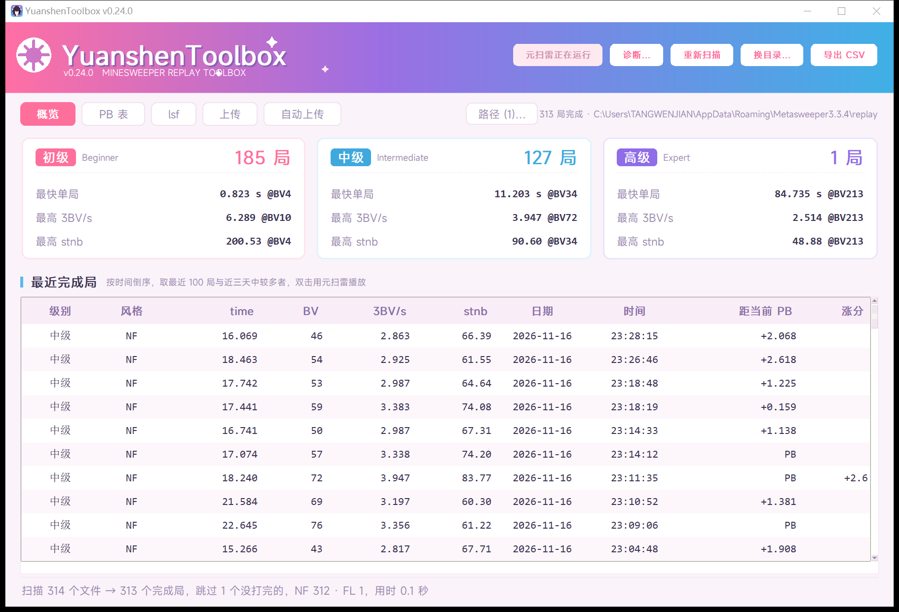
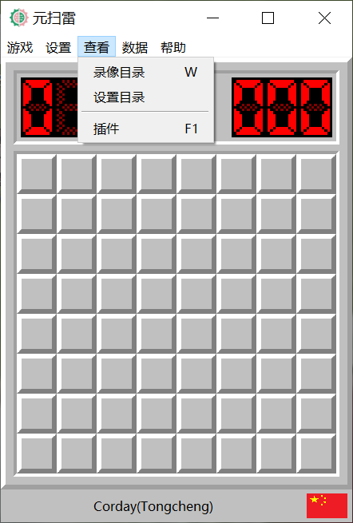
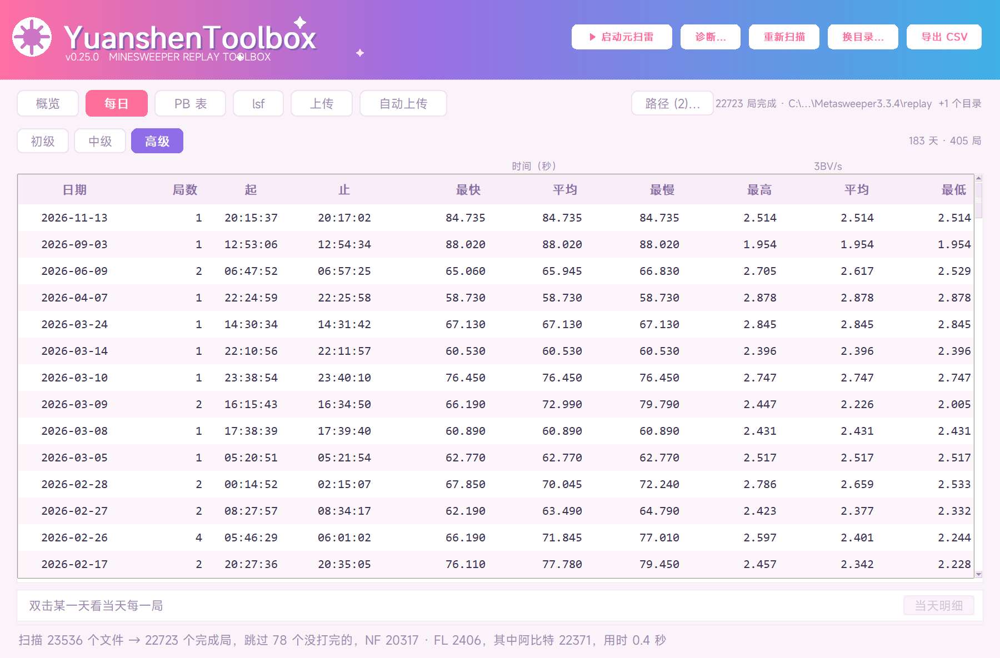
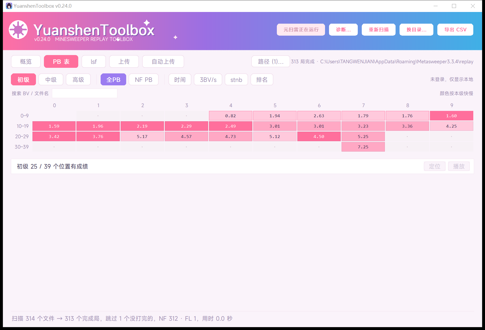
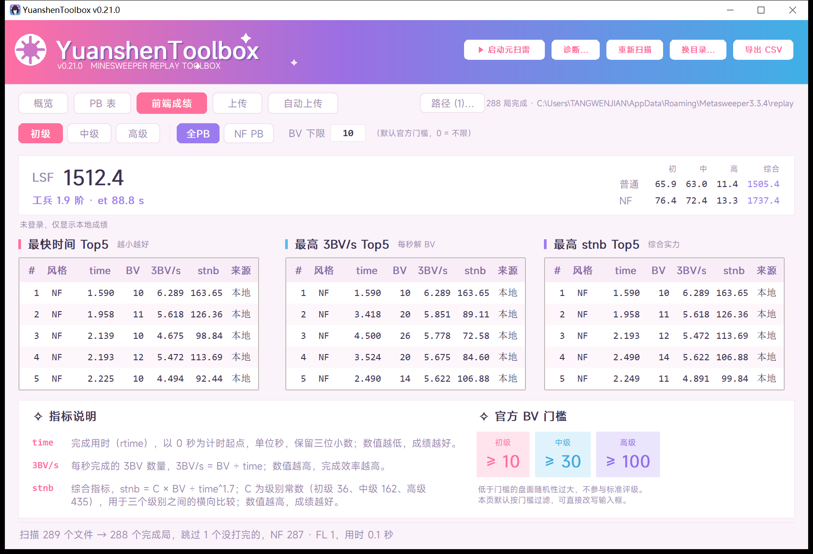
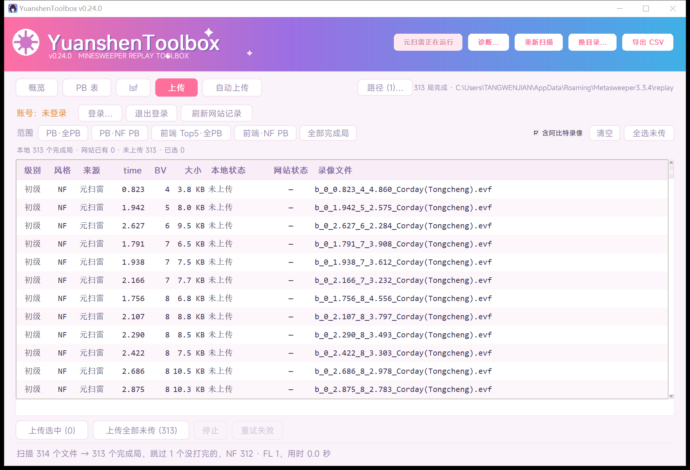

# YuanshenToolbox · 元神工具箱

扫本地扫雷录像，统计 PB 和 LSF，一键传到[开源扫雷网](https://openms.top)。
元扫雷（`.evf`）和阿比特（`.avf`）都认。

原生 Windows 窗口，单文件 exe，只读录像、不起后台服务。

作者：扫雷网 #27415 · 开源扫雷网 #3



## 下载

到 [Releases](https://github.com/Corday-nkusky/yuanshen-toolbox/releases/latest) 下最新的
`YuanshenToolbox.exe`（约 27 MB），双击即用，不需要安装、不需要 Python。

文件名固定、不带版本号 —— 升级直接覆盖同名文件，桌面快捷方式一次建立永久有效。
当前版本看窗口标题，或右键 → 属性 → 详细信息。

## 第一次打开

**把 exe 放到元扫雷的 `Metasweeper<版本号>\` 目录**（和 `replay` 同级）。程序先认自己旁边的
`replay`，连选都不用选；找不到就搜 `%APPDATA%` / `%LOCALAPPDATA%` 下所有 `Metasweeper*` 的
`replay`；再没有才让你手动指一次，指完记住。

不知道 `replay` 在哪：元扫雷菜单「查看 → 录像目录」（快捷键 `W`），返回上一级就是推荐位置。



首次扫描要逐局重演录像，**两万局约 3 分钟**，之后走缓存一秒内出结果。扫描在后台线程，
窗口不会假死。

**阿比特的目录不会自动加。** 它的安装目录里常堆着下载来观摩的录像，自动收进来会把别人的
成绩算成你的。要加就在「路径…」里手动添加，添加前会提醒你：目录里的录像会全部计入成绩统计，
混有别人的录像要先移出去。

## 六个页签

| 页签 | 看什么 |
|---|---|
| 概览 | 三级别各多少局、最快单局 / 最高 3BV/s / 最高 stnb；最近完成局比当前 PB 慢多少、这局涨了多少分 |
| 每日 | 按天一行：那天打了多少局、几点到几点、当天最快 / 平均 / 最慢 |
| PB 表 | 每个（级别 × BV）的最快局，一张 3BV 网格 |
| lsf | 三张 Top5（时间 / 3BV/s / stnb）+ 个人 LSF 卡片 |
| 上传 | 挑范围、把本地成绩传到 openms.top |
| 自动上传 | 开着它打局，新成绩自己传上去 |

### 每日：按天看自己练了多少

一天一行，按**打的那一局开始时刻**归日（跨午夜的算在开始那天）。每行给出局数、
起止时刻，以及当天时间的「最快 / 平均 / 最慢」和 3BV/s 的「最高 / 平均 / 最低」。
中间那列是**算术平均**，与 Arbiter 的 Daily Review 同口径。



- 不做「近 30 天 / 90 天」这类筛选：有局的日子最多几百行，滚动就够，
  而"从哪天开始练、总共练了多少天"本身就是要一眼看见的信息。
- 时刻来自**录像头里的时间戳**，不是文件修改时间 —— 拷贝、解压把 mtime 全改掉也不影响。
  `.avf` 存的是本地墙钟、`.evf` 存真 UTC，两种格式在读取时就归一化。
- 双击某一天（或点「当天明细」）列出当天每一局，双击某一局直接用元扫雷播放。
- 级别单选：三级的 BV 分布完全不同，混着算的"平均时间"没有意义。

### PB 表：一张 3BV 网格

行是 BV 的十位段，列是个位，一格一个 BV。网格从本级别的起点开始画（初级 2、
中级 30、高级 100，初级那一行的 0、1 两格留空），往上画到你打出的最大 BV 所在的那一段，
中间没打过的段整行留着 —— 哪一段断着一眼就能看见。



- 格子里的数字可切时间 / 3BV/s / stnb / 全国名次；颜色表示这个 BV 在**全国**的位置
  （`名次 / 该 BV 总人数` 分四档）。没登录、拿不到名次时，颜色退到本级 3BV/s 的三分位。
- 点一格看这一格的成绩，双击（或点详情条上的「播放」）用元扫雷播这一局的录像。
- 搜索是**给命中的格子描紫边**，不隐藏别的格子 —— 隐藏会让网格出现假断层。

### lsf

三级 × 三项的 Top5，默认按官方 BV 门槛过滤（初级 10 / 中级 30 / 高级 100，页面上可改）。
页顶卡片是个人 LSF、定阶和等价 et，右边是普通 / NF 的各级软实力；点「明细」看每一项
由哪五局撑着。

登录后三张表会把网站的前端 Top5 一并纳入，来源列标「本地 / 网站 / 两边」。



## 统计口径

**只统计标准模式。** 无猜、强/弱可猜、win7、upk、自定义盘面这些录像一条都不进统计，
也不上传 —— 玩法难度不可比，混进 PB 就是把账算错。判据取自录像本身：元扫雷看文件名
第二段（只有 `0` 算标准），阿比特看录像里的 `level` 与 `mode`。跳过的条数写在扫描结束那行。

**非完成局不算**，文件名带 `_fail` 的直接跳过。

**同一局存了多份只算一局** —— 阿比特破纪录时导出的 `HI-SCORE *.avf` 和正本逐字节相同，
归档子目录里也常各存一份。判定只看文件字节，不看指标（阿比特时间只有 10 ms 精度，
按指标合并会误删真局）。磁盘上一个文件都不动。

**两张榜**：

| 榜 | 含义 |
|---|---|
| 全PB | 每个（级别 × BV）的最快完成局，不管用不用旗 |
| NF PB | 只在 `rce = 0` 的局里取最快 |

`rce` 是右键有效插旗数：只算「第一次标到雷格」，同一格插旗取消再插只算一次，
所以 `rce` 恒 ≤ 雷数。`rce = 0` 判为 NF。**FL 不单独成榜** —— 它只是「全PB 的获胜局
碰巧用了旗」，风格列会标出来。

登录后 PB 表把网站 PB 一并纳入，每个（级别 × BV × 榜）取本地和网站中更快的那个，
来源列标「本地 / 网站 / 同速」；网站行没有本地文件，文件列写成 `网站 #录像id`。

## 上传



第一次点「登录…」，输用户名、密码、验证码。**勾着「保持登录 90 天」，之后不用再输密码** ——
程序保存的是站点的 `session_id` Cookie，不是密码；Cookie 和密码都是 Windows DPAPI 密文。

- **范围多选叠加**：PB·全PB、PB·NF PB、前端 Top5·全PB、前端·NF PB、全部完成局。
  登录后 PB 范围会先对照网站 PB，本地更慢的不再进范围（同速保留），统计行写明排除了几条。
- **不会重复传**：先拉网站上已有的录像，按站点自己的去重口径 `timems + bv + file_size`
  逐个比对，命中的标成「网站已有」。
- **单条失败不拖垮整批**：断网 / 超时按 1s → 2s → 4s 退避重试，`503` / `429` 听
  `Retry-After`；只有账号级错误（登录失效、额度满、未实名、封禁）才停整批。
- **断点续传**：传到一半关掉程序，重开后已成功的那几条不重传。
- **标识不符会在本地提前拦**：录像里的标识和你账号「标识管理」里任何一条不完全一致
  （空格、全角半角都算不同）时标「标识不符」——这种传上去也不进任何榜单。
- 上传前弹确认框，列出这一批的级别 / 时间 / BV / 大小 / 文件名。选中项散在上万行里时，
  这张清单是唯一能看清「我到底要传什么」的地方。

范围右侧的「含阿比特录像」决定 `.avf` 参不参与这次上传，默认勾上。

### 自动上传

开着这一页打局，新成绩落进目录一两秒内就被发现，符合勾选范围就传走。全程不弹窗、
不抢焦点 —— 元扫雷在前台跑的时候，一个弹窗就能毁掉这一局。

- 三个独立开关：涨分局、全PB、NF PB，默认开前两个。
- 开关打开**之前**的成绩一律不补传；关机期间打的那几局，下次启动会补上（按录像时间判断）。
- 只传元扫雷的 `.evf`：阿比特目录是手动加的、可能混着别人的录像。
- 会被冻结的、标识不在账号里的不传 —— 传上去也不进榜，只是白占额度。
- 账号级问题只暂停不弹窗；网络连续失败等几分钟再试。
- 最近 100 条记在这一页，含时间、级别、原纪录多少、结果如何。

## 数据在哪里

全部在 exe 同目录的 `YuanshenToolbox-data\`：

```
config.json        录像目录等设置
openms.json        用户名 + 密码 / 会话的 DPAPI 密文
uploads.json       已传记录（断点续传用）
auto-uploads.json  最近自动上传的记录
scan-cache.db      录像解析缓存（删了只是下次扫描变慢）
logs\app.log       运行日志
logs\crash-*.txt   崩溃时的完整 traceback
```

删掉这个文件夹 = 回到全新状态（目录重选、账号重登）。

密码和 Cookie 都是 **Windows DPAPI 密文**，绑当前 Windows 用户 + 本机，换机器解不开，
文件里查不到明文。日志里只有事件和结果，不含密码、验证码、Cookie。

exe 放在 `C:\Program Files` 这类不可写的位置时，数据落到 `%APPDATA%\YuanshenToolbox\`，
「诊断…」里会写明。

## 出问题时

点「诊断…」：数据目录、最近日志都在这。可以导出诊断包（`system.txt` + 配置 + 日志；
凭据只写「有没有、用户名是谁」，不含任何密文），也可以清空扫描缓存重扫。

崩溃会写 `logs\crash-<时间>.txt` 并弹一个带路径的提示框 —— 打包成窗口程序后没有控制台，
不接管的话异常只会让窗口直接消失、什么都不留。

## 开发

```
app.py        tkinter 界面
core.py       扫描 + 统计（纯逻辑，无 GUI 依赖，可单独 import）
openms.py     站点客户端：登录 / 会话 / 去重 / 上传
autoup.py     自动上传的判定与执行
autolog.py    登录与会话续期
mslaunch.py   查找并启动元扫雷、把它的窗口切到前面
cache.py      录像解析缓存（sqlite，按修改时间 + 大小失效）
paths.py      运行时数据目录（exe 旁便携目录 / 回落到 %APPDATA%）
diag.py       日志、崩溃兜底、诊断包
journal.py    已传记录
test_*.py     回归测试与页签截图
build.cmd     打包（含启动自检、归档、部署）
```

```bash
python app.py                 # 直接跑源码
python app.py --tab pb        # 指定启动页（overview / pb / top / upload / auto）
python test_smoke.py          # 界面冒烟回归，退出码判定
python test_upload.py         # 上传页回归（临时目录，不联网）
build.cmd                     # 打包 + 自检 + 部署到录像目录
```

运行时第三方依赖只有 `ms-toollib`（Rust 写的 `.evf` 解析扩展）；`pyinstaller` 只在打包时用，
`pillow` 只在重新生成图标和截图时用。

更多：[构建与发版](docs/BUILD.md) · [更新日志](docs/CHANGELOG.md) ·
[技术笔记](docs/notes.md)（rce 判定、文件名格式、图标、DPI、界面实现细节）·
[待办](docs/TODO.md)

## 许可

代码 MIT，见 [`LICENSE`](LICENSE)。

界面字体 **MiSans** © 小米，免费商用，随 exe 一起分发（运行期用 GDI 私有注册，
不写入系统字体目录）。

窗口图标是二次元角色头像的二次创作，**版权归原权利人，仅作个人/非商业使用**；
要商用请先把 `icon.ico` 换成自己的图。

本工具只读本地录像、只调用开源扫雷网的公开接口，与元扫雷、阿比特、开源扫雷网
均无隶属关系。
